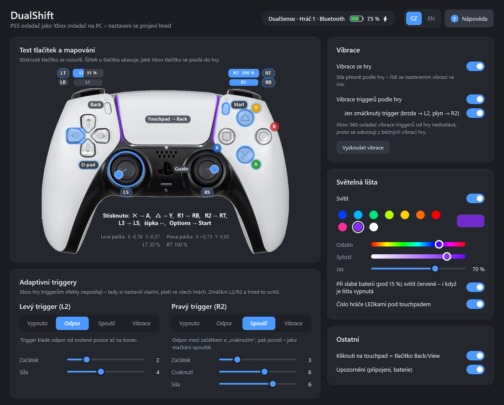

# DualShift – PS5 to Xbox for PC

[English](README.md) · **Česky**

Aplikace v oznamovací oblasti (vedle hodin), která z PS5 ovladače **DualSense** (a DualSense Edge) udělá
**virtuální Xbox 360 ovladač**. Funguje tak i ve hrách, které PS5 ovladač nepodporují.

**[⬇ Stáhnout nejnovější verzi](https://github.com/Tnlrk/dualshift/releases/latest)** – jeden soubor `DualShift.exe`, stačí spustit.



## Co umí
- **Moderní okno nastavení** (vše na jedné stránce, změny se projeví hned) s **testem tlačítek a mapování**: na fotce ovladače se stisknutá tlačítka
  rozsvítí, ukazuje polohu páček a triggerů a u každého tlačítka je štítek s Xbox tlačítkem, které posílá.
- USB i Bluetooth, více ovladačů najednou (každý dostane vlastní Xbox ovladač).
- Vibrace ze hry (zap/vyp). Síla přesně podle hry, řídí se tedy nastavením vibrací ve hře.
- **Adaptivní triggery L2/R2**: odpor, spoušť s cvaknutím, vibrace v triggeru. Navíc volba
  „Vibrace triggerů podle hry“ – volitelně jen zmáčknutý trigger (brzda → L2, plyn → R2).
- Barva světelné lišty (hned při výběru), jas nebo vypnutí, LEDky s číslem hráče, červená lišta při slabé baterii.
- Ikona v liště ukazuje **baterii** (barevný sloupec), **nabíjení** (blesk) a **spojení** (BT/USB).
  Windows tě upozorní na připojení, odpojení, slabou baterii a plné nabití.
- Volitelné skrytí originálního ovladače před hrami (HidHide), aby se vstupy nezdvojovaly.
- Spouštění s Windows.
- **Čeština / English** – přepínač jazyka v okně nastavení (CZ | EN) i v menu v liště; výchozí podle jazyka Windows.
- **Nápověda přímo v aplikaci** – tlačítko „Nápověda“ v nastavení nebo v menu v liště.

## Mapování tlačítek
| DualSense | Xbox |
|---|---|
| ✕ / ○ / □ / △ | A / B / X / Y |
| L1 / R1 | LB / RB |
| L2 / R2 | LT / RT (analogově) |
| L3 / R3 | LS / RS |
| Create | Back / View |
| Options | Start / Menu |
| PS | Guide (Xbox tlačítko) |
| Klik na touchpad | Back (dá se vypnout) |

## Instalace (i na jiný PC)
1. Stáhni `DualShift.exe` z [Releases](https://github.com/Tnlrk/dualshift/releases/latest) (nebo ho zkopíruj třeba z flashky) a spusť ho.
2. Pokud na PC chybí ovladač **ViGEmBus**, aplikace ho nabídne nainstalovat (je přibalený, potvrdíš UAC).
3. Při prvním spuštění nabídne i **HidHide** (skrývání originálu). Po instalaci může být potřeba restart.
4. V menu v liště zapni **Spouštět s Windows**. Exe se zkopíruje do `%LocalAppData%\DualShift`,
   takže původní soubor můžeš smazat.

.NET instalovat není potřeba, je součástí exe. Vyžaduje Windows 10/11 (x64).

## Tipy
- **Steam**: pokud hraješ přes Steam, vypni v nastavení ovladačů podporu PlayStation ovladačů,
  jinak Steam DualSense zachytí také.
- **Skrytí originálu** zůstává aktivní i po ukončení aplikace. Dokud je zapnuté, uvidí PS5 ovladač jen
  tato aplikace. Hry s nativní podporou PS5 (vč. adaptivních triggerů ze hry) ho pak neuvidí.
  Vypneš ho v menu (zruš zaškrtnutí „Skrýt originální PS5 ovladač…“).
- Adaptivní triggery nastavené v aplikaci platí pro všechny hry. Xbox hry triggerům vlastní efekty neposílají.
- Xbox 360 ovladač vibrace triggerů od hry nedostává, proto se odvozují z běžných vibrací hry.

## Vývoj
```
dotnet test          # testy protokolu (parser, výstupní reporty, CRC32, mapování, lokalizace)
./build.ps1          # testy + přenosný dist\DualShift.exe
```
Potřebuješ .NET 8 SDK. Struktura: `DualSense/` (HID protokol), `Bridge/` (ViGEm + správa zařízení), `HidHide/`,
`Setup/` (přibalené instalátory ovladačů v `Redist/`), `Localization/` (texty CZ/EN a nápověda), `UI/` (ikona v liště, okna nastavení a nápovědy ve WPF).

Náhledy vykreslení (bez spuštění aplikace): `$env:PREVIEW_DIR="C:\nejaka\slozka"; dotnet test --filter PreviewRender`.

## Poděkování
- Ovladače [ViGEmBus](https://github.com/nefarius/ViGEmBus) a [HidHide](https://github.com/nefarius/HidHide) od Nefarius Software Solutions (BSD-3-Clause), přibalené instalátory.
- [HidSharp](https://www.zer7.com/software/hidsharp) pro přístup k HID.
- Produktová fotka DualSense (`src/DualShift/Assets/dualsense.png`) je obrázek třetí strany použitý pro ilustraci.
  PlayStation, DualSense a Xbox jsou ochranné známky svých vlastníků; projekt není spojený se Sony ani Microsoftem.
