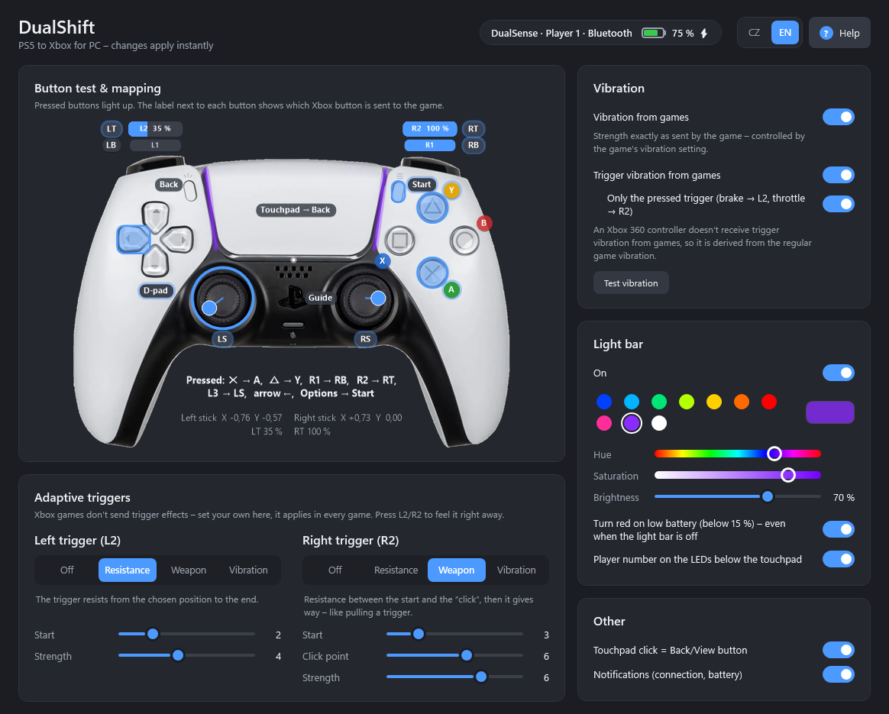

# DualShift – PS5 to Xbox for PC

**English** · [Česky](README.cs.md)

A Windows tray app that turns a PS5 **DualSense** (and DualSense Edge) controller into a **virtual Xbox 360 controller** –
so it works even in games that don't support PS5 controllers.

**[⬇ Download the latest release](https://github.com/Tnlrk/dualshift/releases/latest)** – a single `DualShift.exe`, just run it.



## Features
- **Modern settings window** (everything on one page, changes apply instantly) with a **live button test & mapping view**:
  pressed buttons light up on a picture of the controller, sticks and triggers show their position, and every button
  has a label with the Xbox button it sends.
- USB and Bluetooth, multiple controllers at once (each gets its own Xbox controller).
- Rumble from games – strength exactly as the game sends it, so it follows the game's own vibration setting.
- **Adaptive triggers L2/R2**: resistance, weapon (resistance with a “click”), vibration. Plus
  **trigger vibration from games**, optionally only on the trigger you are pressing (brake → L2, throttle → R2).
- Light bar colour (instant swatches + hue/saturation sliders), brightness or off, player LEDs, red light bar on low battery.
- Tray icon shows **battery** (coloured bar), **charging** (lightning bolt) and **connection** (BT/USB).
  Windows notifications for connect, disconnect, low battery and fully charged.
- Optional hiding of the original controller from games (HidHide) to avoid doubled input.
- Start with Windows.
- **Czech / English** UI – switch in the settings window (CZ | EN) or in the tray menu; defaults to the Windows language.
- **Built-in help** – the “Help” button in settings or in the tray menu.

## Button mapping
| DualSense | Xbox |
|---|---|
| ✕ / ○ / □ / △ | A / B / X / Y |
| L1 / R1 | LB / RB |
| L2 / R2 | LT / RT (analog) |
| L3 / R3 | LS / RS |
| Create | Back / View |
| Options | Start / Menu |
| PS | Guide (Xbox button) |
| Touchpad click | Back (can be turned off) |

## Installation (also on another PC)
1. Download `DualShift.exe` from [Releases](https://github.com/Tnlrk/dualshift/releases/latest) (or copy it from a USB stick) and run it.
2. If the **ViGEmBus** driver is missing, the app offers to install it (it is bundled; confirm the UAC prompt).
3. On first start it also offers **HidHide** (hiding the original controller). A restart may be required after installing.
4. Turn on **Start with Windows** in the tray menu. The exe is copied to `%LocalAppData%\DualShift`,
   so you can delete the original file.

No need to install .NET – it is included in the exe. Requires Windows 10/11 (x64).

## Tips
- **Steam**: if you play through Steam, turn off PlayStation controller support in Steam's controller settings,
  otherwise Steam captures the DualSense too.
- **Hiding the original** stays active even after the app exits. While it is on, only this app can see the PS5 controller,
  so games with native PS5 support (including adaptive triggers from the game) won't see it.
  Turn it off in the tray menu (“Hide the original PS5 controller from games”).
- Adaptive triggers set in the app apply to every game – Xbox games don't send trigger effects themselves.
- An Xbox 360 controller can't receive trigger rumble from games, so trigger vibration is derived from the regular game rumble.

## Development
```
dotnet test          # protocol tests (parser, output reports, CRC32, mapping, localization)
./build.ps1          # tests + portable dist\DualShift.exe
```
Requires the .NET 8 SDK. Structure: `DualSense/` (HID protocol), `Bridge/` (ViGEm + device management), `HidHide/`,
`Setup/` (bundled driver installers in `Redist/`), `Localization/` (CZ/EN texts and help), `UI/` (tray icon, WPF settings and help windows).

Render previews without running the app: `$env:PREVIEW_DIR="C:\some\folder"; dotnet test --filter PreviewRender`.

## Credits
- [ViGEmBus](https://github.com/nefarius/ViGEmBus) and [HidHide](https://github.com/nefarius/HidHide) drivers by Nefarius Software Solutions (BSD-3-Clause), bundled installers.
- [HidSharp](https://www.zer7.com/software/hidsharp) for HID access.
- The DualSense product photo (`src/DualShift/Assets/dualsense.png`) is a third-party image used for illustration.
  PlayStation, DualSense and Xbox are trademarks of their respective owners; this project is not affiliated with Sony or Microsoft.
